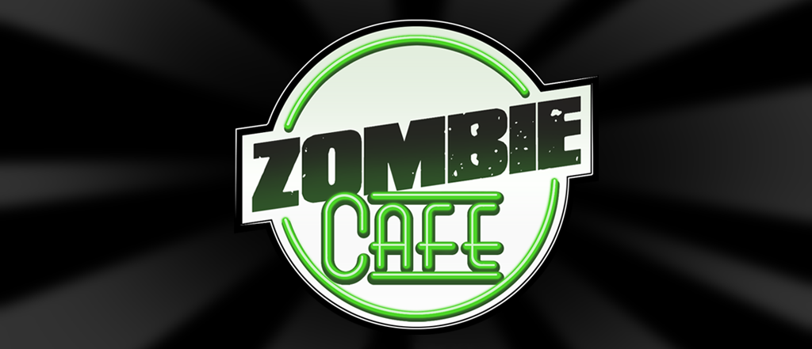

# Zombie Cafe JP

The final Japanese release of Capcom's *Zombie Cafe*, translated into English and bug-fixed for Android.

[Download v0.1](https://github.com/dark-chocolate-enjoyer/zombie-cafe-revival-jp/releases/tag/v0.1)

For the English version (game version 1.1.2.0a), check out [Zombie Cafe Revival](https://github.com/dark-chocolate-enjoyer/zombie-cafe-revival-android).

How it was made: [AI workflow](https://dark-chocolate-enjoyer.github.io/zombie-cafe-revival-android/) · [Technical write-up](https://dark-chocolate-enjoyer.github.io/zombie-cafe-revival-android/technical-writeup.html)

## Project

This project restores the final Japanese release of *Zombie Cafe* (1.7.0, 2016) - which has much more content compared to the latest English version - with a full translation from Japanese to English.

The latest version v0.1 fixes memory bugs in the original code that newer Android versions expose, and adds the cash-to-Toxin exchange to the store.

The work is based on inspection of the game's native ARM code, Smali application layer, packed binary data, and assets.

## Current release

**v0.1** includes:

- A full English translation
- Fixes for memory bugs in the original code, including the crash when leaving the cafe for the map
- The cash-to-Toxin exchange in the store

Download: [v0.1 release page](https://github.com/dark-chocolate-enjoyer/zombie-cafe-revival-jp/releases/tag/v0.1).

## Requirements

- A phone that supports 32-bit apps. Pixel 7 and newer and Galaxy S24 and newer can't install it. Tested on a Samsung Galaxy A54.
- If Capcom's original Japanese Zombie Cafe is installed, uninstall it first (this deletes its save).

## English version

For the English version, with its balance overhaul and music fix, check out [Zombie Cafe Revival](https://github.com/dark-chocolate-enjoyer/zombie-cafe-revival-android).

## Credits

The cash-to-Toxin exchange and the build tooling are based on [Airyzz's Zombie Cafe Revival](https://github.com/Airyzz/zombie-cafe-revival).

*Zombie Cafe © Capcom / Beeline Interactive. Fan preservation project, not affiliated with Capcom.*
